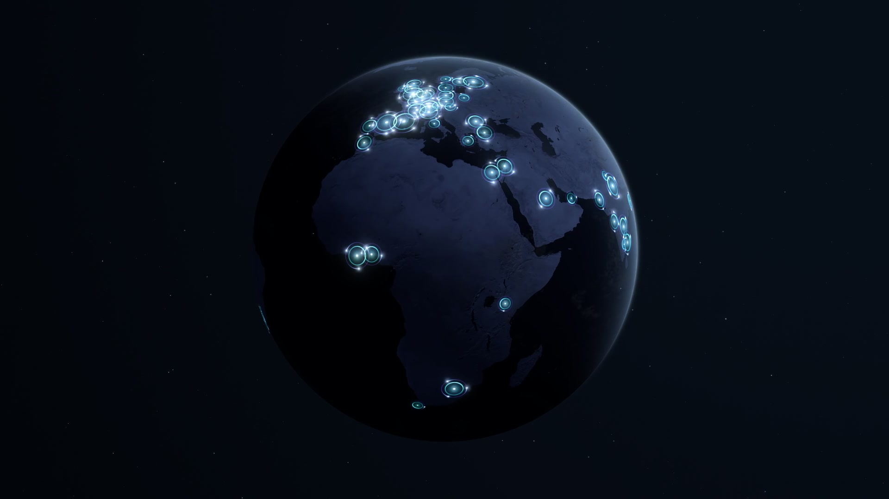
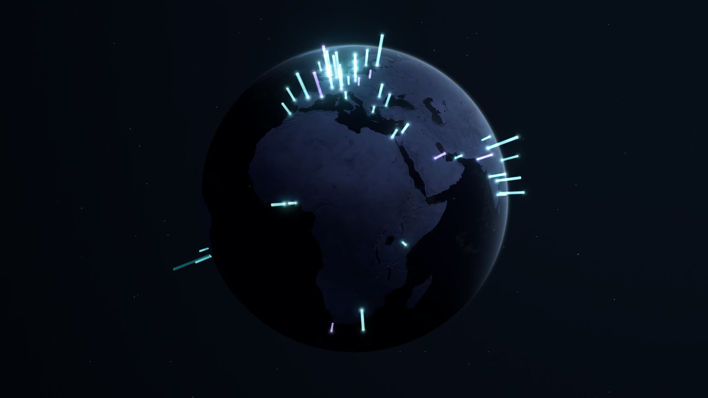

# Active users — two visualisation styles

Historical previews of the removed simulated-user experiments. The application now shows the ambient globe only; these recordings do not represent the current view, and the old `style` parameters have no effect.

## Surface halos

Thin cyan filaments and violet orbital paths follow the surface of the Earth. Each city has a halo whose approximate area reflects its active-user count, with one orbiting light per user. The 200 lights revolve slowly over 58–74 seconds, leaving small fading trails. This is an artistic presence cue, not real movement or a relationship between cities.

[Play the halo rotation video](active-users-halos.mp4)

- 1920 × 1080, H.264 MP4, 30 fps, 60.03 seconds, approximately 10.8 MB.
- Normal 280-second globe revolution, original exposure, and tone-mapped HDR bloom.
- Silent canvas capture with no camera movement or DOM controls.

## Preserved columns with upward flow

200 simulated concurrently active users across 94 city regions, shown as luminous cyan/violet beacons. The data is fictional and does not represent real tracking. All 200 base locations remain visible, while each city shares one thicker column. Its height reflects that city's active-user count, not census population. Colour remains decorative.

[Play the updated slow-rotation video](active-users-upward-flow.mp4)

A broad, soft highlight moves from base to tip in approximately 11 seconds, on staggered 26-second cycles. Steady bases and tips replace the previous brightness breathing. Denser cities reach up to 0.235 Earth radii above the surface, compared with the original decorative maximum of 0.1.

- 1920 × 1080, H.264 MP4, 30 fps, 60 seconds.
- Normal 280-second revolution speed, with no camera movement or speed-up.
- Original scene exposure; HDR bloom is tone-mapped to standard dynamic range.
- Silent canvas capture, without the application's DOM count or fullscreen button.

[Previous thin-beacon version](active-users-slow-rotation.mp4) · [previous still](active-users-poster.jpg)
