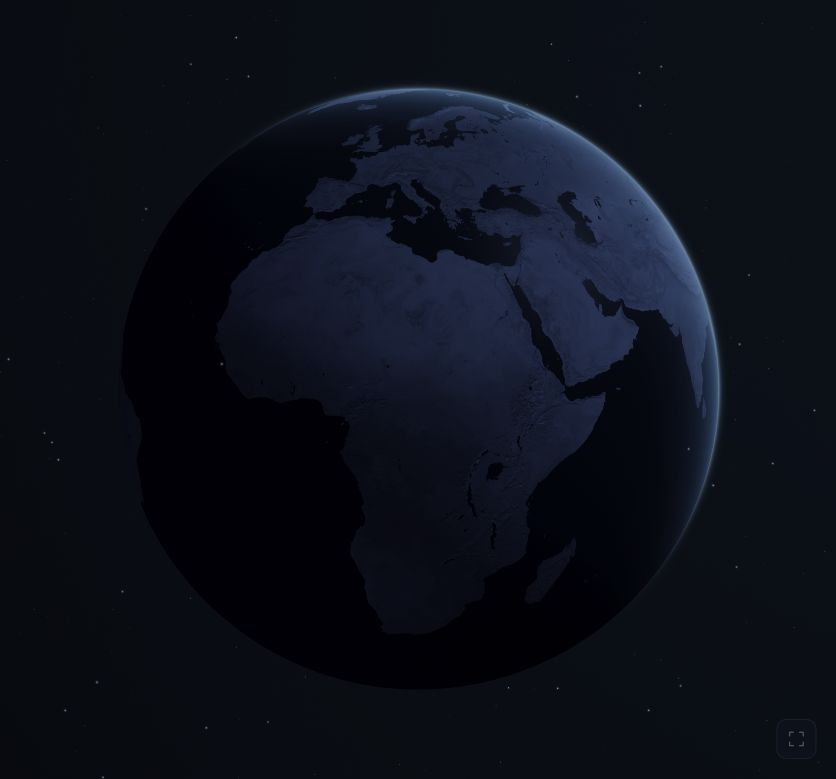
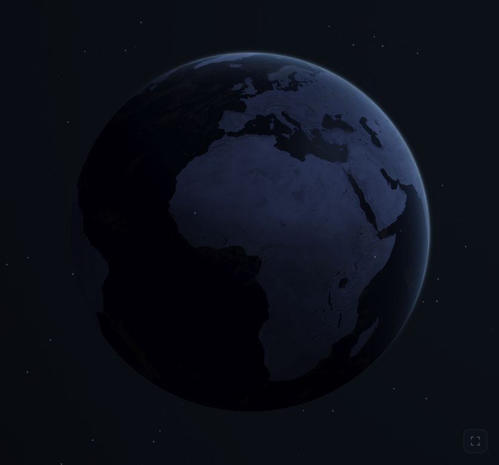
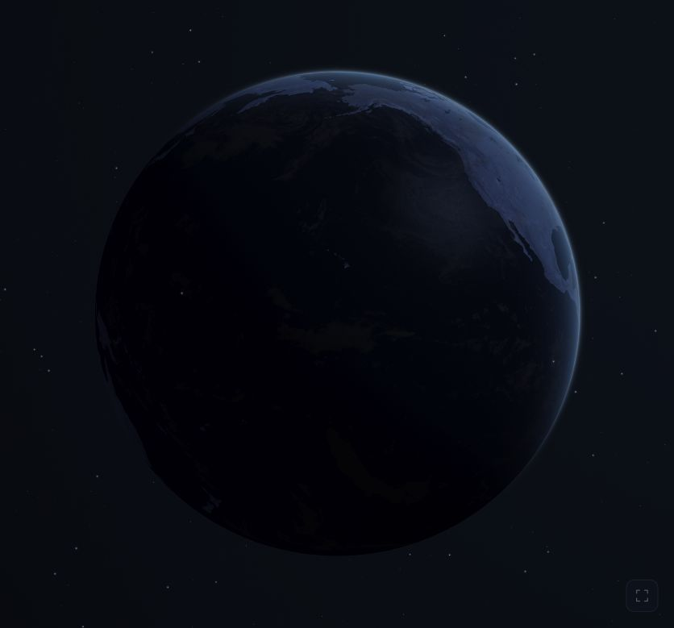
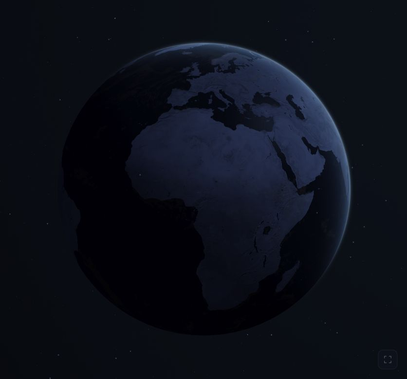
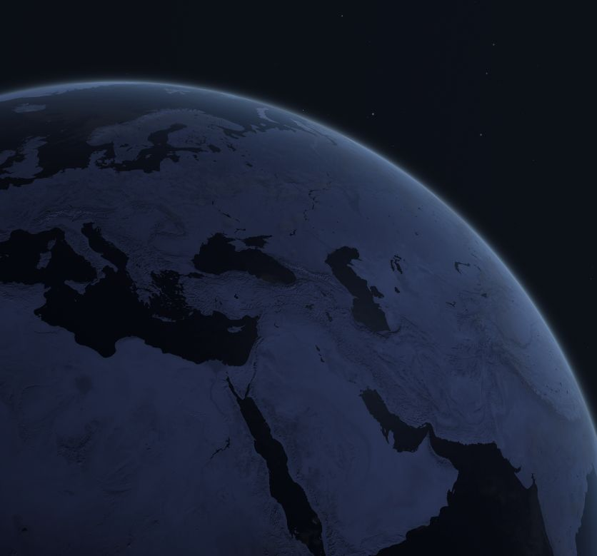
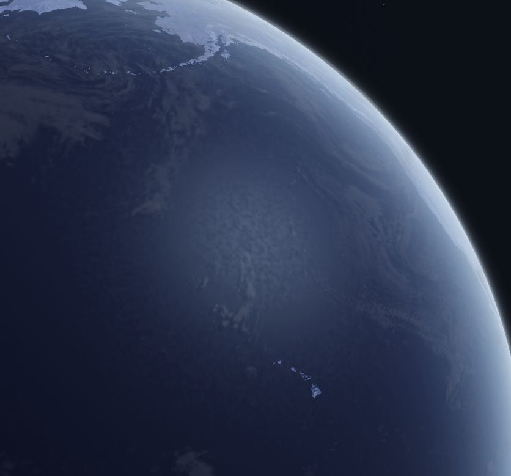
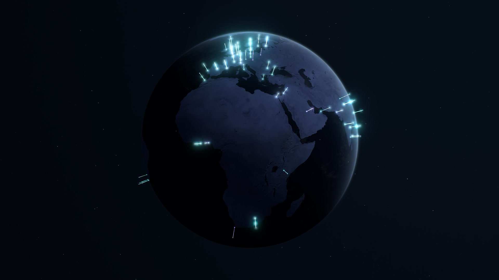
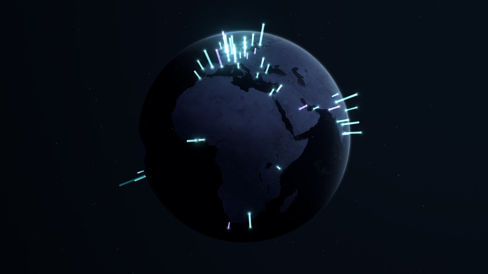
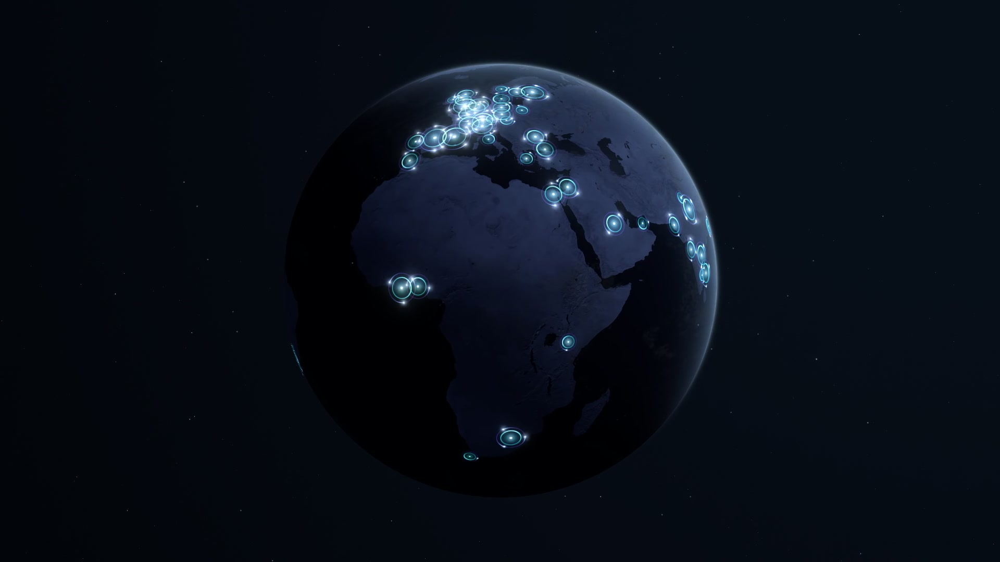

# Visual refinement layers

Added and captured individually on 8 November 2026. These views are cumulative: each stage includes the preceding layers. Cloud drift and satellite glints are best judged in the running scene.

## 1. Directional atmosphere

A thin, cool crescent follows the illuminated limb, with a quieter shadowed edge.

## 2. Clouds and faint shadows

A barely visible cloud shell drifts independently above the terrain and casts subtle shadows.

## 3. Ocean reflection variation

Fine roughness variation softens the ocean highlight. This capture uses a Pacific-facing view; the usual opening orientation was restored afterward.

## 4. Satellite lighting

Satellites fade through the Earth's shadow and catch occasional soft glints. Their travel speed is unchanged.

## Water close-up

A static close-up off North America's Pacific coast uses the existing Earth surface shader, with clouds and atmosphere hidden for inspection. The camera is aimed at the ocean reflection.

- [Normal exposure](water-closeup-original.jpg): the application's exposure of 1.05.
- [Brighter inspection view](water-closeup-bright.jpg): exposure raised to 4.2 (two stops) to reveal the fine roughness variation on small screens.

These captures do not change the application's shader, lighting, or camera defaults. The temporary capture page was removed afterward.

## 5. Horizon haze

A faint haze reduces terrain contrast as the surface curves toward the illuminated horizon. It uses the viewing path through a thin air layer and the existing light direction, with the cool charcoal colour treatment retained.

The comparisons use an identical stationary scene at normal exposure, including the existing clouds and particles. No brightness boost was applied. The temporary capture page was removed afterward.

- Full globe: [before](05-haze-before.jpg) / [after](05-haze-after.jpg).
- Horizon close-up: [before](05-haze-before-close.jpg) / [after](05-haze-after-close.jpg).

## 6. Angle-dependent ocean reflections

The water now combines a fine specular highlight with a broader sheen that grows at shallow viewing angles. Both follow the existing light and cloud shadows. The added reflection is restricted to the water mask and uses a restrained, desaturated tint.

The before/after pairs show the same stationary Pacific view with all existing layers. The brighter pair uses exposure 4.2 instead of the application's 1.05 in both images, making the subtle difference easier to inspect on a phone. The application's exposure is unchanged. The temporary capture page was removed afterward.

- Normal exposure: [before](06-ocean-before-close.jpg) / [after](06-ocean-after-close.jpg).
- Brighter inspection: [before](06-ocean-before-bright.jpg) / [after](06-ocean-after-bright.jpg).
- [Full globe at normal exposure](06-ocean-after.jpg).

## Archived data experiments

The following stages are historical. All simulated-user overlays were removed from the running application on 9 November 2026; their code is archived under `experiments/active-users/`.

## 7. Simulated active users

200 fictional concurrently active users are shown across 94 city regions, with cyan/violet light beacons and selective HDR bloom. The original slow rotation and globe treatment are retained.

[View the 60-second 1080p rotation video and details](../previews/README.md).

## 8. Thicker columns with slow upward flow

Each city now has a softly edged column whose height reflects its simulated active-user count. All 200 user base lights remain. The brightest clusters are taller, while a broad highlight rises gently along each column in about 11 seconds. Base and tip lights stay steady.

[Watch the updated 60-second rotation](../previews/active-users-upward-flow.mp4).

## 9. Alternative surface halos

This experiment uses a separate surface-halo renderer with the same 200-user fixture. Thin cyan/violet filaments hug the globe; each city halo contains one orbiting light per user. Halo area reflects city count, while slow orbital motion and short trails give the view a quieter texture. The tall columns were restored after this review; both data styles were subsequently removed from the application.

[Watch the halo rotation](../previews/active-users-halos.mp4).

